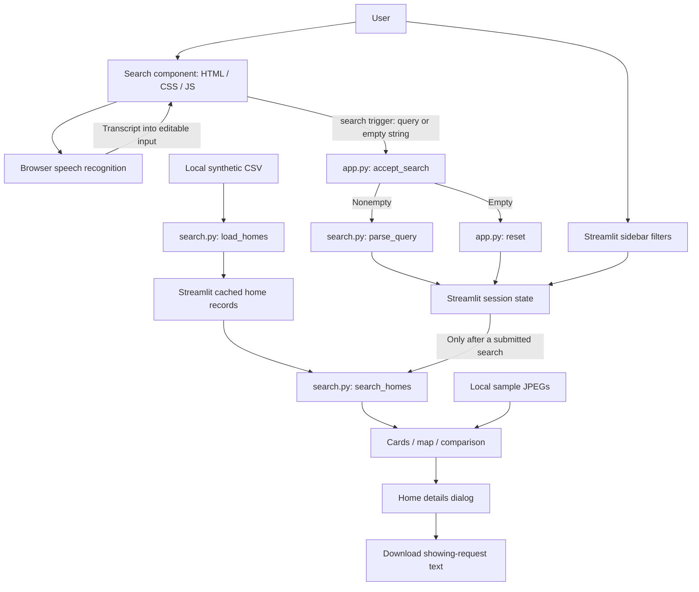

# Architecture

[Back to README](../README.md)

## Source layout

| File or directory | Responsibility |
| --- | --- |
| `app.py` | Streamlit layout, callbacks, session state, cards, details, map, comparison, footer, photo selection, walking-time display |
| `search.py` | CSV loading and normalization, generated drive times and coordinates, query parsing, filtering and ranking; independent of Streamlit |
| `voice_search.py` | Suggestion strings and registration of the Streamlit v2 search component |
| `components/search_box/search.html` | Search input, microphone/Stop SVGs, submit button, live status, suggestion container |
| `components/search_box/search.css` | Search styling, responsive rules, icon visibility based on `aria-pressed` |
| `components/search_box/search.js` | Typed submissions, suggestions, empty-input events, speech recognition and cleanup |
| `synthetic_real_estate_data.csv` | 2,500 synthetic property records |
| `assets/homes/` | Seven bundled sample JPEGs |
| `tests/` | Python search/UI tests and mocked JavaScript component checks |
| `pyproject.toml`, `uv.lock` | Dependency requirements and resolved dependency versions |
| `Data Needed_True_Home_Search.docx` | Reference document; not loaded by the running application |

## Component diagram

## Execution and data flow

1. `app.py` registers page settings, loads cached home records, and initializes missing session values.
2. `voice_search.py` registers a v2 component from local HTML, CSS, and JavaScript strings. Component styling is isolated by the v2 component's default style isolation.
3. JavaScript emits a `search` trigger for submit, suggestion click, or empty input. `accept_search()` runs as the event callback.
4. A nonempty query updates supported filters and sets `has_searched = True`. An empty query calls `reset()`.
5. When `has_searched` is false, the application renders the footer and calls `st.stop()` before creating results, sort controls, or tabs.
6. After a search, `search_homes()` applies filters and sorting. Streamlit renders the result count, sort control, three result tabs, and footer.
7. Sidebar changes rerun the app. Comparison buttons and loading more cards update session state and explicitly rerun it.

`data()` is decorated with `st.cache_data`. The CSV modification time is passed as its cache key, so a changed CSV timestamp causes a reload. Generated values and normalized records are returned with the loaded data.

## Session state

Sidebar defaults are documented in [Search behavior](search-behavior.md). Additional state includes:

| Key | Purpose / initial value |
| --- | --- |
| `query` | Last submitted query; initially empty |
| `has_searched` | Results visibility gate; initially false |
| `home_search` | Component state and transient search event |
| `page_size` | Number of cards to render; initially 12 |
| `compare` | Selected home IDs; initially empty, maximum four through the UI |
| `query_warning` | Whether the most recent query contains selected unsupported terms |
| `sort` | Result sort widget value, present while results are rendered |

Reset restores sidebar defaults, clears the submitted query and warning, hides results, and resets card count to 12. It does not explicitly clear comparison selections or reset sorting. There is no database-backed persistence or saved-search feature.
